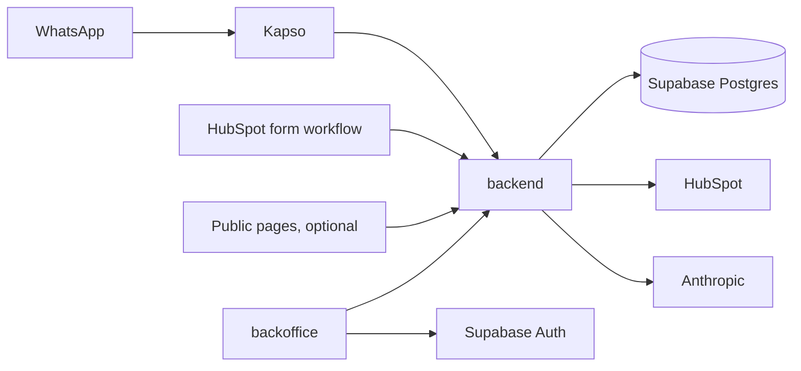
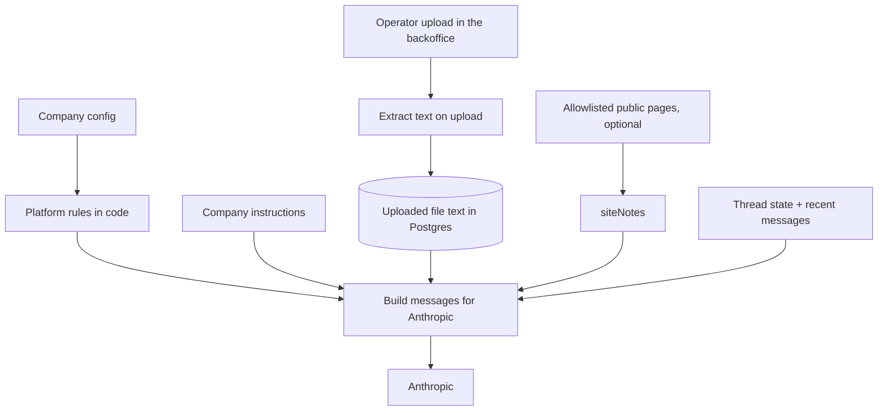

# Design — WhatsApp lead assistant (v1, first client: Altamira Uruguay)

Internal design for Luis. The commercial contract with Altamira is the HTML proposal. This file is how we build it.

**Status:** Altamira accepted. Kickoff is on and the v1 build exists (backend, backoffice, tests, Docker image, CI). Live HubSpot, production WhatsApp, and their Anthropic key are still week-1 access; until then a company with no key for an integration runs on an in-process fake (development only). v1 knowledge is files operators upload in the backoffice. Google Drive / Sheets sync is later.

## Goal

Qualify WhatsApp leads, answer the questions that repeat, and hand a clean summary to a human advisor in the CRM. The assistant does not book visits, does not quote future rental yields, and does not replace the sales team.

Altamira Uruguay is the first client. Volume they reported: about 15–20 leads/day and ~60 conversations/day. About 70% write outside office hours.

**Product goal:** the same system should later be sold to other companies with the same problem (real-estate developers first). Version 1 ships only what Altamira needs, but the code is built as a multi-company product from day one. See [Multi-company](#multi-company).

## Repo layout

One repo, two apps. No Turborepo.

```
backend/      TypeScript HTTP service (Express). Kapso WhatsApp webhook, conversation engine, CRM, knowledge uploads.
backoffice/   Next.js (client-side), shadcn (preset b1Z5bafVA), Tailwind, React Query. Threads, pause, knowledge files, company secrets.
docs/         Proposal, meeting notes, this design.
docker-compose.yml   Local Postgres (plus a test database).
```

The backoffice calls the backend over HTTP. It does not talk to Postgres. Shared types can live in a small `shared/` folder later if duplication becomes painful; do not add that on day one.

Backend source layout:

```
backend/src/
  features/<resource>/        one controller + one service per endpoint, plus a routes file per resource
                              (threads, knowledge, secrets, settings, companies, me, kapso-webhook, whatsapp-connection, form-leads). Services call Prisma directly.
  engine/                     pure: turn decisions (states, qualify gate), prompt building (platform rules + company instructions + knowledge), history, guardrails
  conversation/               the pipeline: record inbound, reply scheduler, one bot turn, CRM sync, sweeper, lease
  integrations/
    whatsapp/                 Channel interface and fake channel; kapso/: webhook parsing, signature, send text/template, connection check
    crm/                      Crm interface, HubSpot adapter, fake CRM
    knowledge/                text extraction from uploaded files
    registry.ts               picks the real adapter or the fake per company
  llm/                        complete() around Anthropic (tool use), and the local fake
  companies/                  company config schema (and the stricter one for saving), starter config and instructions, encrypted secrets, loading a company
  http/                       session auth, platform-admin allowlist, company access (support access + audit), input validation, error handler
  lib/                        env-free helpers: Prisma client, logger, crypto, phone numbers
backend/prisma/               schema, migrations, development seed (Altamira's config lives in seed-data/)
backend/scripts/              terminal chat, signed test webhook, debug company secret, add an operator
```

The engine never imports HubSpot, Google, Kapso, or Meta directly. It talks to small interfaces (`Crm`, `Channel`, `LlmClient`). Adding a second CRM means a new adapter folder, not a rewrite.

## Stack

| Layer | Choice | Why |
| --- | --- | --- |
| Language | TypeScript | Same language in both apps. |
| Backend | Express 5 on Node 22, deployed as a Docker image | Familiar HTTP server. A small always-on container so the webhook and LLM call are not cut off. The container applies migrations on start. |
| Backoffice | Next.js 16 + shadcn (preset `b1Z5bafVA`: base-vega style on Base UI, blue theme) + Tailwind 4 + React Query, client-first | UI and routing only. Pages are client components, data via React Query against the backend. Cache Components are off. Layout from the shadcn `dashboard-01` block. |
| Database | Supabase Postgres | Managed Postgres. |
| ORM | Prisma 7 with the `pg` driver adapter | Schema and all queries from the backend. Runtime uses the Supabase pooled connection; migrations use the direct connection (`prisma.config.ts`). |
| Auth | Supabase Auth (browser client in the backoffice) | Email login. Public signup off. The backoffice sends the Supabase JWT to the backend. An operator row maps the login to one company. A signed-in email on `PLATFORM_ADMIN_EMAILS` can open Empresas with no operator row and no companies. |
| LLM | Anthropic (`claude-haiku-4-5` to start) | Already agreed with Altamira. Each company uses its own API key. One `complete()` wrapper so a later provider swap is one file. No fine-tune. No multi-provider framework. |
| WhatsApp | Official WhatsApp Cloud API through Kapso (a Business Solution Provider) | The company's own number in its own Kapso project and its own Meta Business portfolio. Meta Cloud API direct was dropped in Oct 2026: the client did not want to set up and maintain a Meta app. See [WhatsApp through Kapso](#whatsapp-through-kapso). |
| CRM | HubSpot API (first adapter) | Direct API. No Zapier / Make / n8n. No HubSpot native AI. |
| Knowledge | Files operators upload in the backoffice | PDF, Word (DOCX, DOC), Excel (XLSX, XLS), OpenDocument (ODT, ODS), PowerPoint (PPTX), CSV/TSV, plain text, Markdown, HTML, JSON. Text is extracted on upload, stored per company, and injected into the prompt. No RAG. Google Drive / Sheets is later. |

## Architecture



1. Kapso posts an inbound message to the company's webhook (`/webhooks/kapso/<slug>`). The backend verifies it with that company's webhook secret, checks the `phone_number_id` is the company's number, stores the message, and returns 200 right away.
2. Processing happens after the response. Messages for one thread are handled one at a time, and a short wait (a few seconds) groups messages a lead sends in a row into one reply.
3. When a reply is needed, the engine loads the company config and the extracted text of that company’s uploaded files, builds the system prompt + knowledge block + recent messages, and calls Anthropic.
4. The model returns structured output: the reply text plus any extracted fields (see [Conversation](#conversation)). The engine updates the thread state from those fields, runs the guardrails, then sends the reply.
5. On handoff or close, the engine upserts the CRM contact and writes the transcript.
6. Operators open the backoffice, sign in with Supabase Auth, and call the backend (with the JWT) to list their company’s threads, pause one, upload, replace, and delete knowledge files, set and clear that company's integration secrets, or edit its settings and instructions.

### WhatsApp through Kapso

Kapso is a Business Solution Provider for the official WhatsApp Cloud API (docs: https://docs.kapso.ai). The client did not want to set up and maintain a Meta developer app, so v1 uses Kapso instead of Meta Cloud API direct. The channel stays behind `Channel` (`integrations/whatsapp/channel.ts`); another provider would be a new adapter folder next to `kapso/` with its own webhook route.

- **Per company:** one Kapso project, the company's own number connected through Meta's embedded signup (Coexistence with the WhatsApp Business app, or a dedicated number), the WABA in the company's own Meta Business portfolio, Meta paid by card in the company's own WhatsApp account (not Kapso credits: a WABA on Kapso's credit line cannot switch to a card later and blocks a move to another provider until Kapso revokes it), and message retention at 30 days on a paid Kapso plan. Never a Kapso-provided number: those are licensed and can be reclaimed.
- **Values in LeadScope:** the phone number id (Meta's id, which Kapso shows; unique column on the company), `kapsoApiKey` (project API key), and `kapsoWebhookSecret` (the webhook's `secret_key`). The panel shows the webhook URL for the company and runs a connection check.
- **Inbound:** a Kapso webhook of kind `kapso`, payload v2, at `/webhooks/kapso/<slug>`, events `whatsapp.message.received` plus the four status events. Batched (buffered) deliveries are read too. History-sync backfills, outbound echoes, and messages another app handles are not answered. A message with only a business-scoped user id (no phone number) is logged and skipped, because threads are keyed by phone.
- **Outbound:** `POST https://api.kapso.ai/meta/whatsapp/v24.0/{phone_number_id}/messages` with `X-API-Key`, Meta's body for text, the welcome template, and mark-as-read with the typing indicator. Kapso's own refusals (`insufficient_credits`, `thread_not_owner`, the 24-hour window) surface as channel errors like Meta's did.
- **Cost:** Kapso Free (2,000 messages/month, 1 number) for testing, Pro (USD 25/month, 100,000 messages, 3 numbers) for production; Meta's fees are separate and paid by the client.

## Multi-company

### Deployment model

One shared deployment for all companies. Every company-owned row has a `companyId`. Every query filters by it.

- With only Altamira, this behaves like a single-client build.
- A new client is a new `Company` row, its config, its secrets, and its WhatsApp number in its own Kapso project, with a Kapso webhook pointed at its own URL on the same backend. No new server or database.
- Fallback: if a client ever requires its own isolated database, deploy the same Docker image a second time with its own environment. Same code, no fork.

### What lives in company config (not in code)

Operators edit all of this in Configuración (see [Company settings](#company-settings)).

- Display name.
- Language and tone (for Altamira: Uruguayan Spanish with “vos”).
- The information to collect (`collect`): up to 10 items, each a key (how it is stored on the thread), a name (for the panel and HubSpot), a short description of what to find out (for the prompt, not a question to read out), and required or optional. Altamira's, the seed's, and the starter config's are interest, budget, and whether they know the projects, all required.
- Forbidden topics in plain language (for Altamira: future rental yield, guaranteed returns). No regex patterns.
- Knowledge limits (`knowledge.*`): 60,000 characters of extracted text per file, 150,000 per company (about 40k tokens of prompt), and 15 MB per original upload. Brochure PDFs are large because of their images, so the upload cap is generous and the text caps do the real work.
- CRM adapter type and property names.
- WhatsApp template names. The phone number id is a unique column on the company, not config, because the webhook finds the company by it. Configuración edits it in Integraciones, next to the Kapso keys (saved on its own; the stored config goes along unchanged, so no config version is written); each change is kept as a version with who and when.
- Business hours, used when offering a call time.
- The fixed lines the engine sends (`messages.*`), the reply cap, and the model settings.

The company's own instructions (free text, `Company.instructions`) sit next to the config. Altamira's "about" line moved there from the config.

### Company settings

Configuración is one page for any operator of the company; there are no admin or member roles in the MVP. A platform admin uses it through support access, and those writes are audited like any other.

- **Asistente** (General, Conversación, Temas prohibidos, Mensajes fijos, Bienvenida y CRM, Modelo y límites) edits the whole config: one draft across those sections and one save bar that appears while there are unsaved changes. Before saving, the API checks it with a stricter schema than the one that loads it: required texts and lengths, a timezone and language the runtime knows, a country libphonenumber supports, one to 10 collect items with unique keys (letters, digits, and underscores, starting with a letter), a Meta template name and language code, a HubSpot internal property name, a `claude-…` model id, bounded numbers, and knowledge limits that still fit the files already uploaded. Unknown keys are rejected. Errors come back per field, in Spanish (a collect item's as `collect.<index>.<field>`, the cap as `collect`). Configs saved before the collect list existed (three `questions`, `forbiddenTopics.patterns`) are upgraded on read and on restore: the questions become the three required items under the same keys, with their wording as the description, and the patterns are dropped. The migration rewrote the stored rows and versions the same way.
- **Instrucciones** edits the company instructions (up to 20,000 characters). **Reglas y prompt** shows the platform rules read-only and, in a side panel, the full prompt the model would receive on the next turn: the cached block (platform rules, instructions, knowledge), the per-turn context for a first-time lead, and the `submit_turn` tool. The preview and the engine build the cached block with the same function.
- **Historial** lists every save of the config or the instructions, newest first, with who saved it, when, and whether it came through support access. Restoring a version re-checks it against today's rules and saves it again as a new version; the one in use stays in the history. Saving or restoring what is already there writes nothing.

Every company has a first version of each: the migration writes one for existing companies, and Empresas writes one when it creates a company.

### Secrets per company

Anthropic API key (`anthropicApiKey`), Kapso API key (`kapsoApiKey`), Kapso webhook secret (`kapsoWebhookSecret`), HubSpot access token (`hubspotAccessToken`), and the form-lead secret (`formLeadSecret`) are per company. A payload saved before Kapso may still hold `metaAccessToken`; decrypting ignores it, the next save drops it, and `npm run secrets:prune -- --apply` removes it everywhere. They are encrypted together on the Company row with AES-256-GCM. The encryption key (`SECRETS_ENCRYPTION_KEY`) lives only in the server environment and is never entered in the panel.

An operator sets these for their own company from Configuración → Integraciones in the backoffice. The API is write-only: it reports whether each secret is set and, when the value is longer than 4 characters, the last 4. It never returns the full secret. Saving a value replaces that one secret. An empty value is rejected, so it cannot wipe a secret; Quitar clears one on purpose. The company id comes from the operator's session, so one company cannot read or write another's keys. The only exception is a platform admin in [support access](#support-access), whose writes are recorded.

`npm run company:secret` still writes the same fields from a checkout, for debugging. It is not how a company sets them.

Platform secrets (database URLs, encryption key, Supabase URL and keys) stay in environment variables. WhatsApp has no platform-wide secret: there is no Meta app, so no app secret or verify token. No Vault in v1. Google access is not a v1 secret. Drive / Sheets sync and a Connect Google OAuth flow are later. MCP is not the plan.

### Creating a company

A fresh database has no companies and no operators. `db:seed` and `operator:add` are local fixtures only (demo threads, a sample file). A production setup does not run them. The container applies migrations and starts; it does not seed.

A signed-in Supabase user whose email is on `PLATFORM_ADMIN_EMAILS` can open Empresas and call `GET /internal/me`, `GET /internal/companies`, and `POST /internal/companies` with no operator row. The check is the session email (the JWT, or the dev token). It is not hardcoded. Company routes (threads, knowledge, secrets) need a company: the login's operator row, or support access below. With neither, the panel sends the admin to Empresas and hides the company pages.

Creating a company writes the company row, the slug, a starter config (display name, the three starter items to collect, default knowledge limits, no welcome template), and the first operator, who gets the Supabase invitation described below. That is how the first company, including Altamira, is created. It does not collect API keys and does not set a WhatsApp phone number id; the company sets that in Configuración → Integraciones. The same page lists existing companies (name, slug, operator emails), each with Entrar. The operator created there sets a password from the invitation and only sees their company. They set secrets in Configuración → Integraciones. An operator whose email is not on the list gets no nav item and 403 on the company routes.

### Archiving and deleting a company

From Empresas a platform admin can archive, restore, or delete a company. Archived companies are hidden from the default list; Mostrar archivadas shows them with Restaurar.

- **Archive** (`Company.archivedAt`) is reversible and deletes nothing. While archived, its operators get 403 `company_archived` on every panel route (the panel shows that reason), support access into it is refused, the WhatsApp webhook ignores its number (messages are not stored and get no reply, like a number with no company), a turn already queued for one of its threads is dropped, and its form-lead hook answers 404. Restoring undoes all of it; messages sent while it was archived are not recovered.
- **Delete** is permanent and asks for the company's slug typed back (`DELETE /internal/companies/:id` with `{ confirmSlug }`; anything else is a 400 `slug_mismatch`). It removes the company and, by cascade, its operators, threads, messages, knowledge files, usage, and settings versions. Each operator's Supabase user is then removed under the same rule as deleting one operator.

### Operators

A platform admin manages a company's operators from Empresas (Operadores in the row's menu) or inside the company through support access (Configuración → Operadores, shown only then). Company operators do not see or call this.

- **Add** saves the operator row, then calls Supabase's admin API with the service role key (`SUPABASE_SERVICE_ROLE_KEY`, server only) to create the Supabase user and email the invitation, whose link lands on `/auth/set-password` of the panel that sent the request (its `Origin`, when it matches `BACKOFFICE_ORIGIN`; otherwise the first exact entry there). `BACKOFFICE_ORIGIN` is a comma-separated list where one `*` may stand for part of the first host label (Render PR previews); CORS uses the same list. The row is linked to that user right away. If a Supabase user with that email already exists with a password, it is linked and no email is sent. If Supabase refuses (no service role key, rate limit, bad key, network), the row stays with the reason in Spanish (`inviteError`), the panel shows it, and Reenviar invitación tries again. An email that is already an operator anywhere is a 409.
- **Resend** sends the invitation again; for an account that already has a password, Supabase does not re-invite, so it sends the password-reset email to the same page.
- **Archive** (`Operator.archivedAt`) blocks that login with 403 `operator_archived` on every panel route until it is restored. The Supabase user is not banned; the API is what refuses it. A platform admin whose own operator row (or company) is archived still gets Empresas.
- **Delete** removes the operator row (files they uploaded keep the text, with no uploader). Their Supabase user is deleted too, unless that login is still an operator elsewhere or is on `PLATFORM_ADMIN_EMAILS`.
- With `AUTH_MODE=dev` an in-memory stand-in replaces Supabase, so local runs never send email.

Every write from Empresas to an existing company (archive, restore, delete, and each operator change) is recorded in `AdminAuditEntry` like a support-access write. An audit entry keeps the company's slug and survives the company's deletion (its company id becomes null).

### Support access

Entrar on Empresas lets a platform admin work inside one company's panel, for setup and support, without an operator row there.

- The panel keeps the entered company per browser tab and sends `X-Company-Id: <company id>` on every API request. Entering and leaving reload the page, so no cached data from one company shows under another.
- The API honors the header only when the signed-in email is on `PLATFORM_ADMIN_EMAILS`. A header naming a company that does not exist is a 404. For everyone else, including operators, the company comes from their operator row and the header is ignored. An admin who is also an operator gets their own company until they send the header.
- `GET /internal/me` then returns that company and `supportAccess: true`. The panel shows a bar at the top, "Viendo como administrador: <empresa>", with Volver a Empresas. The sidebar shows the company pages and hides Empresas while inside.
- Every write (POST, PUT, PATCH, DELETE) on a company route made this way is recorded in `AdminAuditEntry` before it runs: admin email, company, method and path, time, and then the response status. Reads are not recorded. Request bodies are never stored, since they can hold secrets. There is no screen to browse the table yet.
- Uploads made through support access have no operator (`uploadedById` is null); the audit entry says who made them.

`prisma/seed-data/altamira.ts` is the local fixture's copy. Production does not apply it.

### Not in v1

Self-signup, billing, a customer admin for their own company, and onboarding wizards. Configuración → Integraciones is not the company-creation screen: an operator only writes secrets for the company they already belong to. Operators cannot add or remove other operators.

## Knowledge

No RAG. No embeddings. No live website browsing during a chat. The v1 source is files operators upload in the backoffice, per company. Text is extracted on upload, stored in Postgres, and pasted into the LLM prompt when the bot answers.

Supported formats: PDF, Word (DOCX, DOC), Excel (XLSX, XLSM, XLS), OpenDocument (ODT, ODS), PowerPoint (PPTX), CSV/TSV, plain text, Markdown, HTML, and JSON. Spreadsheets become one CSV block per sheet. Plain-text files saved as Windows-1252 or UTF-16 (common from Excel and Notepad) are decoded correctly.

Extracted text is capped so it fits the prompt. The defaults live on the company config: **60,000 characters per file** (`knowledge.maxCharsPerFile`), **150,000 per company** (`knowledge.maxCharsTotal`), and **15 MB per upload** (`knowledge.maxFileBytes`). An upload over a cap is rejected with a message that says by how much; it is never silently truncated, because a cut could drop a price.

Uploads are checked before parsing: the extension must be supported and the first bytes must match it. A PDF with no text layer (a scan) is rejected and the operator is told to upload a version with text. Only the extracted text and metadata are stored, not the original file. Uploading a file with the same name (any case) replaces it; "Reemplazar" on a row swaps a file for one with another name. Operators can preview the extracted text, so a badly exported file is caught before the bot quotes from it.

Allowlisted public pages (`siteNotes`) are not built in the MVP; uploads cover the same facts. They stay optional for later.

### How facts reach the chatbot



Five pieces, kept separate on purpose:

1. **Platform rules (in code)** — behavior shared by every company and anything the engine depends on: answer only from the knowledge block, find out the configured items naturally (any order, one question at a time, never re-asking what the lead said), the `submit_turn` fields the engine parses, the lead goes to an advisor only after every required item, `needsHuman` and `forbiddenTopic` mean the fixed line goes out and the bot waits, and replies only inside WhatsApp's 24-hour window with no follow-ups. Edited by Luis. Configuración shows them read-only.
2. **Company config** — the company-specific parts filled into those rules: name, language, tone, the items to collect, forbidden topics, the fixed lines.
3. **Company instructions** — free text the company writes in its own words, placed right after the platform rules. The prompt says the platform rules win if the two disagree, and the engine enforces the parts that matter in code anyway (state, guardrails, window).
4. **Uploaded files** — the commercial source. Price-from, typology, delivery, and orientation come from the extracted text. Re-uploading a file replaces its previous version. If the operator does not re-upload, prices go stale. Full inventory and unit-level availability stay with the advisor and are not dumped in chat.
5. **Allowlisted public pages → `siteNotes`** — optional and secondary. Stable facts only (address, amenities, neighborhood). A scheduled fetch can strip the HTML to plain text. Skip it when no allowlist is set. The bot does not open URLs while chatting.

At reply time the backend:

1. Loads the extracted text of that company’s uploaded files, plus site notes when they exist.
2. Formats them into a short **knowledge block** (structured text, not a vector search).
3. Sends to Anthropic: system prompt (platform rules filled from the config + company instructions + knowledge block, cached) and the conversation turns.
4. The model answers only from that. If a fact is not in the block, it says it does not know and offers the advisor.

Google Drive / Sheets sync, and a Connect Google OAuth flow, are later. MCP is not the plan. Still no RAG.

Conflict rules:

1. Price, typology, delivery, orientation, and availability → the uploaded files win over `siteNotes`.
2. If a fact is missing from both → the bot says it does not know and offers the advisor.
3. Never answer a forbidden topic (for Altamira: future rental yield or guaranteed returns).
4. Never crawl or fetch a URL while answering a lead.

## Conversation

The model writes the reply and extracts data. The engine owns the state.

### Structured output

Every model call returns, through Anthropic tool use (`submit_turn`, built per company from its config):

- `reply` — the text to send.
- `collected` — one entry per collect item key, filled when the lead's own messages state it, in a few words; null when the turn adds nothing. Values are text (a yes/no item is "Sí"/"No" plus any detail).
- `callTime` — when the lead agrees to a call.
- `intent` — one of `continue`, `qualified`, `not_interested`. `not_interested` stays explicit: it closes the thread and writes the CRM with no advisor.
- `needsHuman` — true for a complaint, an existing purchase, or a lead who insists on a person.
- `forbiddenTopic` — the forbidden topic (copied from the config's list, which is the schema's enum) the lead asked about or the reply would touch; otherwise null. Any non-empty value counts as flagged.
- `summary` — two to five short bullets for the advisor: what happened and what the lead wants. Rewritten every turn from the whole conversation (the previous one is in the turn context) and stored on the thread (`Thread.summary`, capped at 1,200 characters); an empty one keeps the previous.

The engine moves the state from those fields. The model never sets the state directly. `qualified` is accepted but moves nothing on its own: the stored required items are the gate. Values under keys the company does not have are ignored.

The system prompt has two blocks. The first (platform rules filled from the company config, the company instructions, all knowledge documents) is identical across turns, so it carries Anthropic's cache breakpoint. The second is per turn: the lead's local time, business hours, each item with what is known, the summary so far, and the next step the engine wants (for example, "ask naturally about one thing still missing: Presupuesto [budget] (required)"). History is the last 40 messages. The call has a 25-second timeout; an invalid tool call is retried once before it counts as a model failure.

### States

1. **Greeting** — welcome, then start finding out the items.
2. **Qualify** — find out the company's items (Altamira: interest, budget, whether they know the projects), in whatever order the conversation allows.
3. **Answer** — reply to repeated questions from the knowledge block. Stay here while they ask.
4. **Handoff** — ask when an advisor can call. Once a call time is captured, write the CRM and stop replying.
5. **Closed** — no interest; write the CRM, do not assign an advisor.

**Paused** is a separate flag, not a state. A human pauses the thread from the backoffice; inbound messages are stored but not answered. Resume returns to the state it had.

### Rules

- Inbound text is stored as-is.
- A non-text message (voice, image, sticker) gets one reply asking the lead to type. No transcription in v1.
- Duplicate webhook deliveries are ignored by WhatsApp `message.id` uniqueness.
- A lead who writes on the API number gets the greeting.
- A lead who fills a form gets one approved welcome template, then the same flow. A HubSpot workflow calls `POST /hooks/crm/form-lead` with the contact’s phone; the backend sends the template. The company pays Meta for that send.
- WhatsApp only allows free-form replies within 24 hours of the lead’s last message. Outside that window, only approved templates can be sent. v1 does not send follow-ups after that window.
- Leave **Qualify** only after every required item is stored (`Thread.collected`, keyed by item key). "No" is an answer. Optional items never hold the handoff. There is no numeric budget minimum in code. `intent` `not_interested` closes the thread even if an item is still open. `intent` `qualified` without the required items does not leave Qualify.
- Once the required items are stored the thread is in **Handoff** and the bot asks for a call time. The turn that stores the call time (with the required items) writes the CRM, once.
- A lead who writes again after **Closed** or **Handoff** reopens the same thread in **Answer**. The thread keeps its history. If that same turn is the one that first completes the required items and `callTime`, it still finishes the handoff and writes the CRM. A later message does not write the CRM again.
- A new answer replaces the stored one (a lead may correct their budget); an empty field never erases one.
- Messages that arrive while the thread is paused or waiting for a person are stored and marked handled. Resuming does not make the bot answer them; it answers from the next message.
- Advisors keep their own personal WhatsApp numbers. The bot never lives on those phones.

### When the bot stops itself (`needsHuman`)

The bot sets `needsHuman`, sends one fixed line from company config, writes the CRM (so the advisor sees the lead in HubSpot, not only in the panel), and stays quiet until an operator clears the flag:

| Cause | Line sent |
| --- | --- |
| The model sets `forbiddenTopic` (the lead asked about one, or its reply would touch one). Reason `forbidden_topic: <topic>` | `messages.needsHuman` |
| The model sets `needsHuman` (a complaint or existing purchase, or a lead who refuses to answer and insists on a person) | `messages.needsHuman` |
| Anthropic fails, times out, or returns an empty or invalid turn | `messages.fallback` |
| WhatsApp refuses the reply (it is stored as a failed message) | none; the panel shows why |

On those two paths the model's own reply is never sent; the engine sends the fixed line. The forbidden-topic flag wins over every other field of the turn. A lead who just asks for a person is not stopped: the bot says an advisor will contact them and keeps collecting the missing items and the call time, so the advisor calls prepared.

### Processing

- The webhook verifies Kapso's signature with the company's secret, stores the messages (and delivery receipts), and only then answers 200. If the database is down, Kapso retries (twice, over about 50 seconds) instead of the message being lost. After many failures in 15 minutes Kapso pauses the webhook and emails the project members; it has to be turned back on in Kapso.
- Replies wait 3.5 s after the lead's last message (at most 15 s from the first) so a burst gets one answer. One turn per thread at a time; a message that arrives mid-turn gets its own turn right after.
- A database lease on the thread stops two containers (for example during a deploy) from answering the same lead.
- A sweeper runs on start and every 30 s: it schedules messages no turn has handled (after a restart) and retries CRM writes that are due.

### Guardrails

- Forbidden topics (for Altamira, rental yield or guaranteed returns) are a plain-language list in company config (`forbiddenTopics.describe`). The model flags one in `submit_turn` (`forbiddenTopic`) when the lead asks about it or its reply would touch it; the engine then sends `messages.needsHuman` instead of the reply, sets `needsHuman`, and writes HubSpot. There is no regex check on replies (removed Oct 2026): the operator writes topics the way they would explain them to a person. The yield-extraction fixtures in `backend/test/fixtures/` run against the engine and the local fake on every test run, and against the real model with `ANTHROPIC_API_KEY` set; that live run is part of prompt tuning.
- If Anthropic fails or times out, send a short fixed message (“te va a contactar un asesor”) and set `needsHuman` on the thread.
- Cap reply length (`maxReplyChars`, 600 for Altamira), cutting at the last full sentence. WhatsApp messages stay short.

## CRM (HubSpot first)

On handoff, close, or when the bot stops itself (`needsHuman`):

1. Upsert the contact by phone, normalized to E.164 so a form contact and a WhatsApp contact match. A contact id from the form payload is used directly. Otherwise search `phone`, `mobilephone`, and `hs_searchable_calculated_phone_number`; create the contact if none matches. A new contact gets the phone, the WhatsApp first name, and the form email. An existing contact's name and email are never overwritten. If HubSpot rejects a create because the email exists, the contact it names is updated instead.
2. Write one long text property (`crm.transcriptProperty`) with, in order: status, phone, name, email, agreed call time (if any), the reason when the bot stopped itself, the assistant's bullet summary, the collected fields (each item's name and value, in config order, then any value stored under a key the config no longer has), and the full transcript. No per-field HubSpot properties. Over 65k characters, the header and the latest part of the conversation are kept. With no property configured, only the contact is upserted.
3. Do not use HubSpot’s native AI module.

CRM writes go through an outbox on the thread (`crmPendingAction`). A failed write is retried with backoff (1 min, doubling, up to 1 h, 12 attempts), the panel shows the error, and an operator can retry it on demand.

How the advisor is notified (owner, task, or both) and the exact property names are decided at kickoff once Luis has HubSpot access.

## Data model (Prisma)

Every table below except `Company` has `companyId`. The schema is `backend/prisma/schema.prisma`.

- **Company** — slug, name, config (JSON, validated by `companyConfigSchema`), instructions (free text), encrypted secrets, WhatsApp phone number id, archived at.
- **CompanySettingsVersion** — one saved config or instructions: kind, the value, who saved it (`createdByEmail`, null for the first version), whether it came through support access, the version it restored (if any), and when. The newest of each kind is what the Company row holds.
- **Operator** — email, Supabase Auth user id (linked when invited, or on first login), companyId, archived at, last invitation sent at and last invitation error. Maps a login to a company.
- **KnowledgeFile** — name, lower-cased name (unique per company, so the same name replaces), format, MIME type, size, SHA-256, extracted text, character count, uploaded by.
- **Thread** — lead phone (E.164) and WhatsApp id, WhatsApp name, form email, source (`whatsapp` / `form`), state, `paused`, `needsHuman` + reason, `collected` (JSON, item key → text; threads from before Oct 2026 were migrated to the keys `interest`, `budget`, `knowsProjects` with "Sí"/"No"), `summary` (the model's bullets), call time, last inbound at (24-hour window), last message at + preview (for the list), processing lease, CRM contact id and outbox (`crmPendingAction`, attempts, next attempt, last error, synced at). Unique on (companyId, phone).
- **Message** — thread id, direction, WhatsApp type, body (or caption), WhatsApp message id (unique), delivery status from Meta's receipts, `handledAt` (inbound: when a turn took it), sent at.
- **LlmUsage** — thread id, model, input/output and cache read/write tokens, latency. Used to see cost per company.
- **AdminAuditEntry** — a write a platform admin made inside a company through support access, or to a company from Empresas: admin email, company id (null once the company is deleted) and slug, method and path, response status, time.

## Backend surface

- `POST /webhooks/kapso/:companySlug` — Kapso v2 events (`whatsapp.message.received`, and `whatsapp.message.sent/delivered/read/failed` for receipts), single or batched. Verified with the company's `kapsoWebhookSecret` (`X-Webhook-Signature`, hex HMAC-SHA256 of the raw body); 401 without a valid signature or while the company has no secret, 404 for an unknown slug, 200 and nothing stored for an archived company. Events whose `phone_number_id` is not the company's number are ignored.
- `GET /internal/whatsapp/connection-check` — Probar conexión: the company's saved phone number id, Kapso key, and webhook secret, then Kapso's phone health and webhook list for that number. Never returns a secret.
- `POST /hooks/crm/form-lead/:companySlug` — form-lead trigger from the company’s CRM workflow. Secret in `X-LeadScope-Secret` (or `Authorization: Bearer`). Accepts HubSpot's "Send a webhook" body as is (`phone` / `mobilephone`, `email`, `firstname`, `lastname`, `hs_object_id`). Sends the welcome template only to a thread with no messages yet.
- `GET /internal/me` — the signed-in email. With an operator row: that operator, their company, `platformAdmin`, and `supportAccess: false`. A platform admin with no operator row gets `operator: null`, `company: null`, and `platformAdmin: true`. A platform admin who sends `X-Company-Id` gets that company and `supportAccess: true`. Anyone else with no operator row gets 403.
- `GET /internal/companies?status=active|archived|all` — platform admin only, with or without an operator row. Companies (name, slug, operators, created at, archived at); `active` by default. No secrets, no threads.
- `POST /internal/companies` — platform admin only, with or without an operator row. Body `{ name, slug, operatorEmail }`. Writes the company, starter config, and first operator, and invites that operator. Returns the company and the invitation outcome. 409 if the slug or email is taken. Extra fields, including API keys, are ignored.
- `POST /internal/companies/:id/archive`, `.../restore`, `DELETE /internal/companies/:id` (body `{ confirmSlug }`) — platform admin only, audited.
- `GET|POST /internal/companies/:id/operators`, `POST .../operators/:operatorId/invite` (resend), `.../archive`, `.../restore`, `DELETE .../operators/:operatorId` — platform admin only, audited. Add and resend return `{ operator, invite }` where `invite.status` is `sent`, `linked`, `reset_sent`, or `failed` with a Spanish `message`.
- `GET /internal/threads?status=&search=&cursor=` — the operator's company threads, newest activity first, 50 per page.
- `GET /internal/threads/summary` — counts per status (they add up to the total).
- `GET /internal/threads/:id` — thread (with `collected` and `summary`), `fields` (the company's items in config order with the lead's value, then values under keys no item has anymore, `required: null`), and messages.
- `POST /internal/threads/:id/pause`, `.../resume`, `.../clear-needs-human`, `.../crm-sync` (retry a failed CRM write).
- `DELETE /internal/threads/:id` — delete a lead's thread and messages on request.
- `GET /internal/knowledge/files` (with usage and limits), `GET /internal/knowledge/files/:id` (with the text), `POST /internal/knowledge/files` (upload; same name replaces), `PUT /internal/knowledge/files/:id` (replace), `DELETE /internal/knowledge/files/:id`.
- `GET /internal/secrets` — whether each company secret is set, and the last 4 characters when that does not reveal the whole value.
- `PUT /internal/secrets/:name` — replace one secret (`anthropicApiKey`, `kapsoApiKey`, `kapsoWebhookSecret`, `hubspotAccessToken`, `formLeadSecret`). Body `{ "value" }`. An empty value is rejected.
- `DELETE /internal/secrets/:name` — clear that one secret. There is no company id on these routes.
- `GET /internal/settings` — config, instructions, the platform rules rendered with that config (read-only), and the current version ids.
- `PUT /internal/settings/config` — the whole config. Validated before saving; a 400 carries `error.fields` keyed by dotted path. Unknown keys, including any attempt at the platform rules, are rejected.
- `PUT /internal/settings/instructions` — body `{ instructions }` and nothing else.
- `GET /internal/settings/versions` — config and instruction versions, newest first, with who, when, support access, and which is in use.
- `POST /internal/settings/versions/:id/restore` — save that version again as a new one. 422 if it no longer passes validation.
- `GET /internal/settings/options` — choices for the Asistente selects: languages, IANA time zones with their UTC offset, countries with calling codes (from `libphonenumber-js`, the validator's own list), and Claude models (from Anthropic's Models API with the company's key, or a fixed list).
- `GET /internal/settings/prompt` — the cached system block the engine would send, the turn context for a first-time lead, the `submit_turn` tool, the model, and the knowledge totals.
- `GET /health`.

Auth: Supabase JWT on `/internal/*`. Current projects sign access tokens with ES256; the backend verifies those with the project's JWKS (`SUPABASE_URL`). The legacy `SUPABASE_JWT_SECRET` is used only for HS256 tokens, so a configured secret does not reject an ES256 session. `Sesión inválida o vencida` is that verification failing (signature, expiry, issuer, or audience), not a missing operator row. An operator row is linked to its Supabase user on first login and scopes threads, knowledge, and secrets to that company. `AUTH_MODE=dev` accepts `dev:<email>` and is refused in production. CORS allows only the backoffice origin and the headers `Authorization`, `Content-Type`, and `X-Company-Id`. Every company query filters by the request's company, and another company's id is a 404. That company is the operator's, or, for a signed-in email on `PLATFORM_ADMIN_EMAILS` that sends `X-Company-Id`, the one in the header (see [Support access](#support-access)). The header is ignored for everyone else. Secret writes use that same company and ignore any company id in the body. `/internal/me` and `/internal/companies` also accept a platform admin with no operator row. Anyone else on `/internal/companies` gets 403.

LLM: one module, `backend/src/llm/anthropic.ts`, that takes the two system blocks + messages and returns the parsed fields. Prompt building lives in `engine/`, not inside the model call.

## Backoffice (v1)

Client-side Next.js. Use the App Router for file-based routing and shadcn setup, but do not rely on SSR or Server Components for data. Pages are client components; React Query talks to the Express backend. Supabase Auth runs in the browser (`@supabase/supabase-js`); the access token is sent as `Authorization: Bearer …` on backend calls.

Pages:

1. Login (Supabase email + password, "forgot password"). No public signup. Invitation and reset emails land on `/auth/set-password`.
2. Conversaciones — status filters with their counts, search by name or phone, and the list (newest activity first) with status, last message, and HubSpot status (shown only once there is a write to report). When threads need an advisor, a notice above the list says how many and filters to them. The sidebar shows the same count.
3. Thread detail — a header with the lead, its status, Pausar / Reanudar asistente, and Eliminar in the overflow menu; the full conversation with delivery ticks, the 24-hour window as a pill, and a line at the end of the transcript once the window has closed; a Lead panel with the assistant's summary (bullets), the company's collected fields (how many required ones are in, optional ones tagged), the call time, contact data, and HubSpot status. The page fits the window and each column scrolls inside itself. Nothing sits between the header and the conversation: what needs action goes at the top of the Lead panel — why the bot stopped with Marcar como atendida (clears `needsHuman`), that an advisor paused it, and a failed HubSpot write with the error and Reintentar. The panel still does not send WhatsApp.
4. Conocimiento — upload (a button, or drag and drop onto the list), list, preview the extracted text, replace, and delete files for the operator’s company, with a strip for the space used, the file count, and the per-file limits. Not a “sync sheet now” button.
5. Configuración — a grouped section nav on the left (a scrolling row on narrow screens), one section at a time, `?tab=<section>` in the URL. Asistente: General, Conversación (tone, reply length, and Información a recopilar: the items, with name, key, what to find out, required or optional, reorder and remove, Agregar dato disabled at 10 with the count shown; a new item's key follows its name until typed), Temas prohibidos (plain-language topics, one per line; no patterns), Mensajes fijos, Bienvenida y CRM, Modelo y límites (the config form split by topic, one draft across them, errors next to each field and a dot on the section that has them, and one save bar that appears only with unsaved changes; Idioma, Zona horaria, País de los teléfonos, and Modelo de Anthropic are searchable selects, and a saved value that is not in the list stays selectable). Prompt: Instrucciones (company instructions) and Reglas y prompt (the read-only platform rules, and the full prompt in a side panel). Empresa: Integraciones (WhatsApp con Kapso: a status pill, the Phone number ID, the Kapso API key, the company's webhook URL with a copy button, the webhook secret, and Probar conexión, with the Spanish step-by-step guide collapsed below, open until the three values are set; then the Anthropic API key, HubSpot access token, and form-lead secret: write-only fields, whether each is set, the last 4 characters when available, and an explicit Quitar; the platform encryption key is not here; a secret's input opens only on Configurar or Reemplazar), Historial (history with a filter by kind, and restore), and, only for a platform admin in support access, Operadores. See [Company settings](#company-settings). The old `/integrations` URL redirects to `/settings?tab=integrations`, and the old `?tab=assistant` opens General.
6. Empresas — only when `GET /internal/me` says `platformAdmin`, including when `company` is null. Create a company (name, slug, first operator email, in the Nueva empresa dialog) and list the companies that exist, with Mostrar archivadas. This is the empty-database setup. No API keys. Each row's menu has Operadores, Archivar / Restaurar, and Eliminar (type the slug). Each active row has Entrar, which opens that company's panel as [support access](#support-access) with the "Viendo como administrador" bar. An operator who is not an admin has no nav item; opening the URL shows that they have no access, and the API answers 403. A platform admin with no operator row and no entered company does not see Conversaciones, Conocimiento, or Configuración.

The panel does not send messages. Advisors answer from their own WhatsApp.

One shared backoffice for all companies: one Vercel app, one URL. The operator’s company comes from their login (`Operator.companyId`), and the backend filters every request by it. No per-company subdomain, branding, or company switcher for operators in v1. A platform admin can list companies and create one without belonging to a company, and enter any of them through support access. Later options on the same app: a subdomain per client and per-company branding.

React Query with polling (every 10 seconds on lists, 5 on an open conversation) is enough at this volume. No realtime subscription in v1.

Shadcn with Luis's preset `b1Z5bafVA` and the `dashboard-01` layout. Per-company branding is not in v1.

## Hosting, environments, and operations

- **Region:** Supabase (Postgres and Auth) and the backend host are **us-east-1** (N. Virginia). Change this only if Altamira’s contract requires LatAm hosting. Do not create the Supabase project in another region.
- **Backoffice:** Vercel.
- **Backend:** Docker image of the Express app, running as one always-on container (Fly.io, Railway, Render, or similar). Supabase Edge Functions are not the app runtime. Supabase stays Postgres and Auth. The host account is still open; the image is the artifact.
- **Single instance:** the sweeper runs inside the container. Keep one instance until work moves to a proper queue; the thread lease covers the short overlap during a deploy.
- **Setup scripts** (`backend/scripts`): `company:secret` is a debug write of one encrypted company secret (operators set secrets in Configuración → Integraciones), `chat` talks to the assistant from the terminal, and `webhook:send` posts a signed test webhook. `db:seed` and `operator:add` are local fixtures only (demo company, sample file, demo threads, an extra operator). A production setup does not run them. The first company and its operators are created from Empresas, which also invites them.
- **Environments:** staging and production, each with its own database and a test WhatsApp number in staging. Prompt changes go to staging first.
- **Platform secrets (env only, never committed):** database URLs (pooled + direct), Supabase URL and keys, secrets encryption key, and `PLATFORM_ADMIN_EMAILS`. A Google service account is later, with Drive / Sheets, not v1.
- **Monitoring:** structured logs, error alerts (Sentry or similar), and `LlmUsage` for cost per company.
- **Testing:** a set of real conversations (from Altamira’s WhatsApp Web access) replayed against the prompt after each change. This complements live tuning; it does not replace it.

## Privacy

- Conversations contain personal data. Follow Uruguay’s data protection law (Ley 18.331).
- Do not log company secrets, message bodies, or phone numbers in plain text. The secrets API never returns a full secret. The support-access audit stores method and path, never request bodies.
- Support deleting a lead’s thread and messages on request.
- Outbound templates only go to leads who gave their phone in a form or wrote first.
- Kapso is one more processor of message content (US hosting, support from Chile). Keep its message retention at 30 days on a paid plan and disclose it under Ley 18.331.

## Out of scope (v1)

Instagram DM, Messenger, email-to-WhatsApp, landing-form automation beyond the one welcome template, mass email / remarketing, Costa Rica (“Erika”), Calendly, native HubSpot AI, voice-note transcription, sending the project PDF presentation, follow-ups outside the 24-hour window, CRMs other than HubSpot, and anything billed as a future version.

Also not in v1: resale features (self-signup, billing, a customer admin for their own company, onboarding). Creating another company is a platform-admin screen, not those features. The architecture is ready for more companies.

Google Drive / Sheets sync and a Connect Google OAuth flow are later, not v1. MCP is not the plan.

## Build order

1. Repo skeleton: `backend/` and `backoffice/`, Prisma schema with `Company`, Supabase Auth, staging deploy.
2. Altamira `Company` row and config; knowledge file upload (extract text, store per company); Conocimiento page to upload, list, replace, and delete.
3. WhatsApp webhook (Kapso): resolve company, store messages, answer fast, per-thread processing, greeting.
4. Engine with structured output: items to collect, answers from the knowledge block, the forbidden-topic flag, fallback.
5. Handoff / close → HubSpot upsert + transcript.
6. Backoffice thread list, detail, pause / resume.
7. Form-lead trigger and welcome template.
8. Optional allowlisted site notes into `siteNotes` (secondary; skip if there is no allowlist). Not built in the MVP.
9. Logging, alerts, usage tracking, replay test set.
10. Live prompt tuning after go-live (ongoing; not a setup checkbox).

## Open at kickoff

- HubSpot property names, and how advisors are notified (owner, task, or both). The property name is set in Configuración.
- Business-hours text, and the approved welcome template's name and wording. Both are set in Configuración once Altamira confirms them.
- HubSpot workflow for the form-lead trigger.
- WhatsApp number connected in Altamira's Kapso project (Altamira's own number, its own Meta Business portfolio, Meta paid by card), Meta business verification, welcome template approval.
- Allowlist of public URLs for site notes.
- Hosting account for the backend.
- Software ownership with Altamira in the signed contract (needed for resale).
- Partnership terms with José Daniel and Luis’s father, if the product is sold together.
